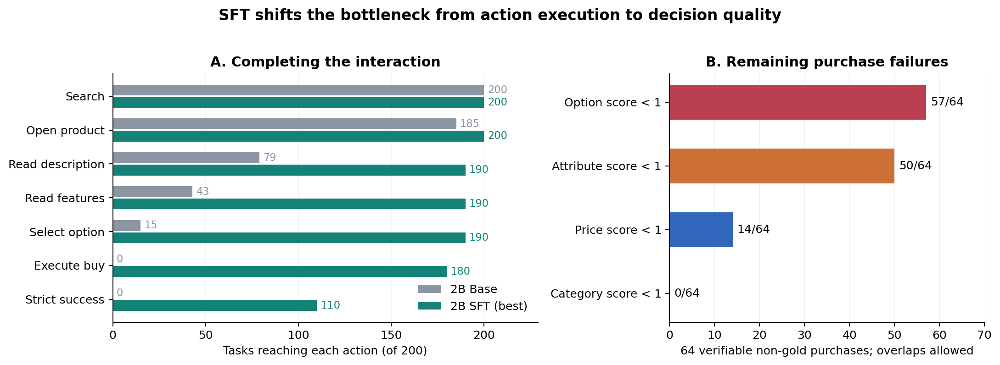
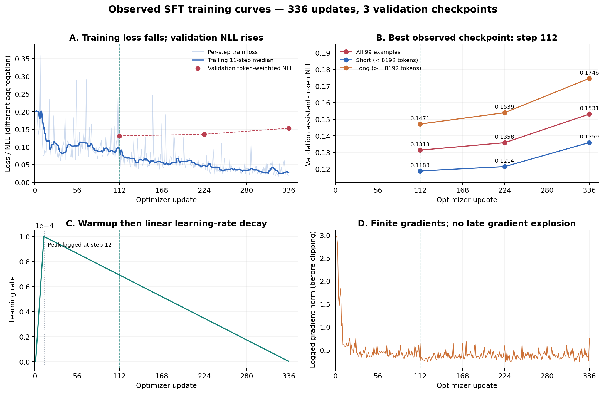

# SFT 训练报告

> 分析对象：Qwen3.5-2B 正式第一版 SFT（`shopping-sft-stage1-v1`）。本文只读取已完成的训练和评测记录，不重新训练、合并模型或运行测试。训练曲线来自真实日志；“模拟监控”指按训练进度解释当时能看到的信号，不生成假想数值。

本次最明确的发现是：**SFT 使模型从“能搜索、但经常无法继续操作”，进步到“能够按页面规则完成选规格、查看信息和购买”。** 固定 200 题的 Strict Success 从 **0/200 提升到 110/200（55%），增加 55 个百分点**。剩余问题集中在候选选择、规格与属性约束、预算执行，以及探索失败后的恢复。

训练侧并非越练越好。**第一轮末的第 112 步是三个已保存检查点中验证 NLL 最低的；第二、三轮训练 loss 继续下降，验证 NLL 却持续上升。** 最终测试使用的是重新加载的第一轮最佳模型，不能把 55% 记作“第三轮末模型的成功率”。

## 1. 证据范围与分析方法

### 1.1 本次使用哪些记录

| 证据 | 本次使用的记录 |
|---|---|
| Base 轨迹与汇总 | [`qwen3.5-2b-strict200-tp2-20261117-145950-492258`](../outputs/evaluation/qwen3.5-2b-strict200-tp2-20261117-145950-492258/)；200 条任务记录（含错误退出） |
| SFT 轨迹与汇总 | [`sft-stage1-v1`](../outputs/evaluation/sft-stage1-v1/)；200 条任务记录（含错误退出） |
| 训练记录 | [`train_summary.json`](../outputs/models/sft-stage1-v1-balanced/train_summary.json)、逐步 profile、三个 `validation_epoch_*.json` |
| 线上监控入口 | [SwanLab 正式 SFT run：`wijfhiq6`](https://swanlab.cn/@WangZIyu/shopping-grpo-sft/runs/wijfhiq6)；本文使用其对应本地日志还原曲线，没有读取网页面板截图 |
| 难度及来源 | [`labels.jsonl`](../data/splits/labels.jsonl)、[`manifest.json`](../data/splits/manifest.json)、正式 SFT 数据名单 |

两组轨迹按 `task_id` 一一配对，均覆盖当前固定测试集的全部 200 题，每题一次 rollout，没有挑选成功重试。测试文件 SHA-256 均为 `e19a03a52d12ecd0635b3227ff11a713b8fe0a271f14c5ccdf07c45bcb2e9913`。两组全部任务的 system prompt 相同；最大步数 35、单次生成上限 512、上下文 24576、temperature=0、top_p=1、观察预算及不压缩上下文的设置一致。

**比较仍有边界。** Base 服务是 TP2、seed42，明确关闭 thinking，并使用中性 generation config；SFT 服务日志是 TP1、seed0，没有显式记录同样的 thinking、reasoning parser 与 generation config 设置。两次运行也不在同一天。因此，这是“相同任务和公共交互协议下的现有运行对比”，尚非仅改变权重的严格控制实验。轨迹足以展示行为差异，但不能精确断言全部 55 个百分点都只由 SFT 权重造成。本报告不为消除这一差异追加测试。

两组都按 ShopSimulator v2.1、Strict Reward、observation v2 和 tools v2 分析。**Strict Success 必须是完整的 `gold_purchase` 终局、`reward_valid=true`，且四个 reward 分量均为 1。** 保持原公式 `r_type × r_att × r_option × r_price`，不改变任何奖励值。全部 400 条记录的成功判定已与仓库现有确定性指标实现逐条交叉核对。

当前训练/验证文件校验和与该训练 run 保存值一致；`prepare_data_splits.py verify` 通过，正式 SFT 为 889/99，来源及重复指令组隔离通过。本次没有重新清洗、标注、筛选或划分数据。

### 1.2 如何回答“学到了什么”

分析沿着“搜索 → 打开候选 → 获取证据 → 选择具体规格 → 作出终局决定”定位中断位置，再检查关键动作前的可见页面与终局四分量。方法参考 [WebShop 原论文](https://papers.neurips.cc/paper_files/paper/2022/hash/82ad13ec01f9fe44c01cb91814fd7b8c-Abstract-Conference.html) 对购物任务中检索、网页理解与决策的区分；这里的数值全部重新从本仓库轨迹计算，不引用论文结果代替本次实验。

归因分为三层，避免把结果标签直接当作认知解释：

- **确定事实**：动作是否执行、是否被守卫拒绝、停在哪一步、终局和 reward 分量是什么；全量程序统计。
- **行为解释**：根据配对轨迹和观察，说明哪一步体现出状态遵循、约束匹配或错误恢复；精选案例逐步核读。
- **机制推断**：这些差异与学到什么能力相符。没有模块消融、中间检查点交互评测或对模型内部表示的测量，不把推断写成已证实的内部机制。

离线使用目标 ASIN 仅定位“候选是否已经出现/打开”，没有把它输入模型，也没有添加 ASIN 奖励。`purchase.instruction_text` 是商品携带的任务文本，可能属于另一条任务；本报告始终以当前轨迹的初始 user instruction 为需求依据。

## 2. 第一阶段：轨迹说明成功率为什么提高

### 2.1 Base 的 0%：主要断在操作闭环，而非完全搜不到

| Base 最终失败类型（互斥） | 任务数 / 200 | 说明 |
|---|---:|---|
| 非法动作达到上限 `invalid_action_limit` | 158（79%） | 当前页不能执行的动作被反复尝试，触发停止 |
| `repeat_loop` | 31（15.5%） | 反复搜索、打开和返回，没有推进终局 |
| `ModelOutputTruncatedError` | 10（5%） | 输出达到 512 tokens，回复不完整，没有执行该动作 |
| `ContextBudgetError` | 1（0.5%） | 输入超过上下文预算 |

Base 在 **185/200** 题中打开过商品，**180/200** 题的实际可见搜索观察中出现过目标商品，甚至 **94/200** 题已打开目标商品；但 **真正执行的 `buy_now` 为 0 次**。因此，0% 不能解释为“200 题都不会检索”，也不能据此判断 Base 完全没有商品理解能力。更直接的结论是：已有检索和局部匹配能力没有转化成完整购物行为。

最常见的错误具有明确的页面状态特征：

- 打开一个商品后，直接点击上一个搜索列表中的其他 ASIN，没有先回到列表。
- 进入 Description/Features 子页后，直接切换另一个子页或选择规格，没有先返回。
- 搜索结果页或详情页不提供搜索时，直接再次调用 `search_products`。

全量共有 **738 次守卫拒绝**，其中 703 次为 `click_not_in_previous_observation`，32 次为当前页不可搜索；明确的多余参数错误只有 1 次，未知工具 2 次。被拒绝的动作中，393 次是 `open_product`。这更支持“没有稳定遵守页面状态和可点击证据”的解释，而不是笼统归为“JSON 不会写”。收到拒绝后仍重复相似非法动作，又暴露出恢复能力不足。

另一个典型问题是用 `back_to_search` 放弃当前商品，然后以接近的关键词重新搜到同一批候选。Base 的 `prev_page` 全部只执行 3 次，反映它很少采用“看完信息子页后回到当前商品继续操作”的路径。

### 2.2 SFT 把哪些环节接起来了



*左图统计“至少执行过一次该动作”的任务数，各行分别统计，不表示固定顺序或逐层筛选。右图只看 64 条可验证的非 gold 购买，维度可以重叠。*

最有解释力的变化有三项：

1. **页面操作变得稳定。** 以“已执行工具调用 + 本地守卫拒绝”为动作尝试分母，拒绝率从 **738/1808=40.8%** 降至 **12/2451=0.49%**；出现过拒绝的任务从 186 题降至 8 题。SFT 剩余 12 次拒绝全部发生在规格选择，已经不是大面积的页面操作失控。
2. **从浏览走向可执行的购买链。** 选择过规格的任务从 15 题升至 190 题，Description/Features 分别覆盖 190 题；`prev_page` 从 3 次增至 506 次；180 题真正执行购买，其中 110 题严格成功。这说明它学会了常见操作序列和具体规格选择。
3. **部分轨迹能把文字需求映射到可选项并作出决策。** 成功案例既有年龄段、款式匹配，也有多个规格轴组合以及跨候选探索，不能只用“终于敢点购买”解释全部成功。

**“会调用查看工具”仍不等于“会使用查看到的证据”。** SFT 在大量失败轨迹里同样读取了 Description/Features，随后仍买错数量、尺寸或预算。这一区别是理解 55% 与剩余 45% 的关键。

Base 平均执行 5.35 步，SFT 平均 12.20 步，不能据此说 SFT 效率下降：Base 多数提前中断，根本没有走完任务。SFT 内部，成功轨迹中位数为 8 步、均值 9 步；失败轨迹中位数 10 步、均值 16.1 步，后者才暴露出探索无效和长尾成本。

### 2.3 三条成功轨迹：具体展示它会做什么

以下步骤从 1 开始编号；箭头表示工具调用先后，省略处只为方便阅读。

**案例一：任务 0，已经找对商品后，终于能完成购物。**

需求：给约 5 岁儿童买泰国天然乳胶枕，满天星图案，预算 1000 元以下。

```text
Base：搜索 → 打开 747848614498（目标商品）
      → 连续尝试打开其他不可见商品 → 三次拒绝，停止

SFT：搜索 → 打开同一个 747848614498
     → 选择“【推荐4-6岁】塔拉蕾乳胶二阶枕：满天星”
     → Features → 返回 → Description → 返回 → 购买
```

最终规格符合年龄与图案，实际价格 **999 元**，四个 reward 分量均为 1，终局 `gold_purchase` 且有效。这里两者已经找到同一商品，SFT 的新增价值主要体现在**后续规格匹配、合法导航和终局执行**，不能把提升全归给搜索。

**案例二：任务 135，把“只买面具、M 码”落实到两个规格轴。**

需求：火影忍者红月之夜系列带土面具，仅面具、不需要其他服饰，M 码，不超过 60 元。

```text
SFT 第2步打开商品 902914368451
第3步 select_option("m")
第4步 select_option("红月之夜单独面具")
第5—8步查看 Description / Features，并逐次返回
第9步购买；实际价格 58 元
```

商品页面同时提供假发、武器、服装套装和单独面具。最终选择了“大小=m”及“颜色分类=红月之夜单独面具”，有效严格成功。这表明模型能够在该案例中处理**排除额外配件的约束和多轴规格组合**。Base 在同题多次于不可搜索的页面发起搜索，最终停于非法动作上限。

**案例三：任务 1125，经过四个候选后成功，展示有限的长程探索能力。**

需求包含砭石、加热、无烟艾灸、礼盒、约 2500mAh、多档调节、精油与艾草饼，价格约 250 元。

```text
第1—7步：搜索并查看候选 A（168 元），未购买
第8—15步：查看候选 B，选定规格价 279 元，离开
第16—19步：查看候选 C，选定规格价 318 元，离开
第20—27步：转向乐尔康候选 D（915148065088）
           → 选择旗舰礼盒：2500mAh、砭石、多档、艾饼、精油
           → 查看信息并返回 → 以 238 元购买，严格成功
```

规范预算对“250 元左右”的上界为 275 元，B、C 的已选规格价均超过这一上界。行为上，它没有在这两个候选处购买，最终选到价格与配置同时通过的 D；这与利用规格和价格证据进行筛选相符。轨迹未记录显式推理，不能断言每一次离开都由价格驱动。

Base 同题第一轮就曾打开最终正确商品，但随后离开、重新搜索，并在其他候选间循环。这再次说明，**检索到答案与能完成任务是两种能力**。

这一长程案例有代表价值，但不能代表普遍水平：110 条成功轨迹中 **97 条只打开过一个不同商品，13 条打开过多个不同商品**。同时有 50 条成功轨迹首次打开的商品并非搜索第 1 名，因此成功也不是全部依赖“永远点第一条”。当前证据支持“稳定的常见短流程，加上有限的多候选探索”，不支持“已普遍掌握复杂购物规划”。

### 2.4 SFT 的 90 条失败：问题转移到了哪里

| SFT 未达严格成功的终局（互斥） | 数量 | 应如何解释 |
|---|---:|---|
| `wrong_purchase` | 53 | 已购买，但 reward 乘积为 0 |
| `partial_alternative_purchase` | 10 | 部分满足，未达到完整四维匹配 |
| `valid_alternative_purchase` | 1 | 四分量为 1，但不是 gold 终局；按当前合同不计 Strict Success |
| `reward_unverifiable` | 6 | 规格或变体价格等证据不可验证，不能算成功 |
| `repeat_loop` | 10 | 重复探索被终止 |
| `max_steps` | 5 | 用尽 35 步 |
| `ContextBudgetError` | 5 | 上下文超限，未完成终局 |
| **合计** | **90** | 固定总分母仍为 200，不删除这些失败 |

在 **64 条可验证、但非严格成功的购买**中，规格分量未满有 **57 条**，属性未满有 **50 条**，价格不通过有 **14 条**，品类分量不通过为 **0 条**。这些维度重叠，不能相加；另外 6 条不可验证购买单列，不能混入已确认的价格违规。

这揭示出当前边界：**SFT 对环境中的粗粒度品类通常能对上，但不能稳定满足细粒度配置和组合约束。** `r_option`、`r_att` 是环境匹配器的指标，并不等于独立人工语义审查结论；以下使用用户原文也能直接确认的案例说明问题。

**错误一：数量、尺寸等硬约束没有约束最终动作。**

| 任务 | 当前用户需求 | 实际动作与结果 | 证据支持的归因 |
|---|---|---|---|
| 730 | 小米 T301 刷头，白色 **6 支**，约 30 元 | 查询已写“6支”，却选择“护龈白-**4支**”，21 元购买；`r_option=0` | 已提取数量，但未在选择/购买时执行 |
| 749 | 接电防水壁灯，长度 **≤35cm** | 查询保留了接电、防水、黑色，遗漏长度；购买“**50cm**接电款”，560 元；`r_option=0` | 查询约束遗漏，之后也没有用尺寸否决候选 |
| 117 | 天空蓝、1.5L 以上保温壶，**50 元以下** | 选择天空蓝 1600ml，最终 **62 元**购买；`r_price=0` | 局部属性匹配掩盖硬预算违规 |

这几条都能熟练地完成“选规格 → 看信息 → 返回 → 购买”，但并未保证买对。特别是任务 730，数量已经出现在模型自己的查询中，不能仅归为“没读懂需求”。更准确的问题是**需求约束没有在最终决策中持续生效**。

**错误二：选项生成不精确，拒绝后又跳过必要步骤。**

任务 1198 需要 3W、可调方向、防雨的圆形埋地灯。SFT 打开正确商品后，尝试选择一个包含 `|` 等改写的规格字符串，被 `click_not_in_previous_observation` 拒绝；随后直接 `buy_now`。最终 `options={}`，价格解析状态为 `effective_price_axis_unselected`，终局 `reward_unverifiable`。

这里的链条很清楚：**未精确使用当前可见的选项值 → 选择没有执行 → 没有修复 → 在规格不完整时购买。** 守卫没有误执行选择。反过来，6 条不可验证购买并非都能归咎于模型：任务 625 的价格解析器报告 `multiple_effective_price_axes`，涉及环境对多轴变体价格的可验证性限制，应与漏选规格分开处理。

**错误三：目标候选已经出现，却没有被有效利用。**

90 条失败里，有 **54 条**的实际可见搜索观察出现过目标 ASIN，但从未打开；另有 14 条打开过目标仍未成功。这个诊断只说明候选利用存在空间，不代表模型当时已经知道谁是目标，也不代表看过 ASIN 就有足够证据判断所有需求。

应关注“哪些可见属性让模型误选了近似候选”“读完详情后为什么仍不否决”，而不能把所有失败都笼统归到检索召回。也不能直接从“看过详情”推导出“模型完成了核验”。

**错误四：多轮探索仍会退化为循环，最终耗尽上下文。**

任务 316 在第 9、13、16 步先后搜索“太阳能长条壁灯 90cm 防水 三色”及近似改写，随后又回到先前候选，第 18 步被 `repeat_loop` 终止。任务 102 则在多个指甲油架候选间搜索、选择、返回，32 个执行步骤后下一次请求超限。SFT 的上下文错误从 Base 的 1 题增至 5 题，不能据此认定记忆能力下降；它也可能反映模型能走得更远后暴露了新的资源瓶颈。

SFT 在 simple/medium/hard 上分别成功 **16/21（76.2%）、70/119（58.8%）、24/60（40.0%）**，呈现结构难度越高越困难的趋势。但难度是已有结构标签，不是对“推理能力”的直接测量，且 simple 只有 21 题，不宜夸大组间差距的精度。

### 2.5 对“为什么成功”的解释应停在哪一层

证据最强的是**合法导航、可见选项使用、常见动作序列和购买闭环**；多约束匹配、多轴选择和候选筛选也有明确成功实例。成功率上涨与这些行为变化相符。

证据尚不支持模型已经稳定掌握：严格的逐项约束核验、对不合格候选的持续否决、异常状态恢复，以及长期有效的探索策略。SFT 的常见路径是先选规格，再看 Features/Description，返回后购买；其中最常见的同一八步动作序列出现 78 次。它可能同时承载有效技能与固定流程模仿，仅凭动作形状无法区分。

教师轨迹上的低 NLL 与自主交互中的成功也不是同一个目标：前者给定教师历史，后者必须面对自己造成的页面状态。序列决策中这种状态分布偏移，是 [DAgger 原论文](https://proceedings.mlr.press/v15/ross11a.html)讨论的模仿学习问题。它能解释为什么值得检查偏离后的恢复，但本次没有做验证该机制的消融实验。

## 3. 第二阶段：真实训练曲线与监控判断

### 3.1 本次实际训练过程

正式数据为收集 1000 条成功轨迹后，仅应用第一阶段长度与合法性筛选得到的 **988 条**，固定为 **889 训练 / 99 验证**；没有使用第二阶段过程质量筛选，也没有补采。使用 Qwen3.5-2B 固定 revision `15852e8c16360a2fea060d615a32b45270f8a8fc`，双卡 FSDP2、BF16/SDPA、LoRA r32/alpha64/dropout0.05，有效 batch8，LR=1e-4，linear、warmup3%，seed42，上下文上限 24576。

总计 **336 次更新、3 个 epoch**，每轮末验证和保存一次；Trainer 训练运行时间 **1003 秒，约 16.7 分钟**。包含训练外准备的记录总耗时约 17.1 分钟，不含随后模型服务启动及 200 题测试。训练结束加载 `checkpoint-112`，再合并该最佳 adapter，完成一次最终测试。

只有 assistant 输出参与监督。Profile 累计约 2037 万上下文 tokens，其中约 **62.95 万为监督 tokens（3.09%）**，累计值包含三轮及分布式采样补齐，不是独立样本数。这个比例提醒我们：上下文吞吐量和实际监督量不同；低 loss 不能被直接读作“长上下文决策已经学会”。

### 3.2 在 SwanLab 上优先看什么

| 优先级 | 指标或图 | 它回答的问题与本次读法 |
|---|---|---|
| 1 | **`eval/assistant_nll`** | 正式选模指标。99 条验证样本去重后，按有效 assistant tokens 加权；三轮同为 22606 个监督 tokens，最低为第一轮 0.13135 |
| 2 | **`train/loss` 与验证 NLL 的联合趋势** | 训练集继续拟合时，未见示范是否也变好；本次从第二轮起发生背离。平滑用于看趋势，保留原始波动 |
| 3 | **`eval/long_nll`、`eval/short_nll`** | 整体均值是否掩盖长序列困难；以总输入 8192 tokens 为界，长 28 条、短 71 条，长组始终更高 |
| 4 | `train/learning_rate`、`train/grad_norm` | 调度是否正常，是否出现 NaN/Inf 或持续梯度异常；本次有正常 warmup/衰减，无后期爆炸信号 |
| 5 | `eval/unique_examples`、`eval/supervised_tokens` | 各轮是否在相同分母上比较；本次始终为 99 / 22606，不能漏看分母变化 |
| 6 | `profile/step_seconds`、`profile/tokens_per_second`、`profile/gpu*_peak_allocated_gib` | 解释慢步、长度波动与显存风险；用于判断运行健康，不代替学习质量 |

`eval/loss` 也实际记录，但它沿用 Trainer 的聚合方式，与去重、token 加权的 `eval/assistant_nll` 不同，**不能互换数字**。本次两者的选模方向一致，仍须以合同规定的 assistant NLL 为准。梯度范数按 Trainer 语义读取，是裁剪前记录值，不能把大于裁剪阈值误读为“裁剪没生效”。

交互成功率、非法动作率、规格完整性与约束违规率是理解能力所需的另一组指标，但**它们不是该 SFT run 已记录的逐步训练曲线**。本次只有 Base 和最佳 SFT 的最终交互结果，没有第 56/112/224/336 步各自的交互成功率曲线，也没有工具参数级准确率、熵或置信度曲线。缺失的指标不能靠 NLL 换算出来。固定 200 题测试始终只用于最终报告。

### 3.3 曲线实际是什么样



*绿色虚线为最佳已保存检查点第 112 步。训练 loss 展示原始值及向后 11 步中位数；验证仅有三个实测点，连接线只帮助阅读，不代表轮内有连续验证。训练 loss 与验证 NLL 的聚合方式不同，绝对间距不直接解释为泛化差距。*

| 轮次 / 步数 | 训练 loss 的逐步算术均值¹ | 验证 assistant NLL | 短序列 NLL | 长序列 NLL | Trainer `eval_loss` |
|---|---:|---:|---:|---:|---:|
| epoch 1 / 112 | 0.11306 | **0.13135** | **0.11880** | **0.14709** | 0.09905 |
| epoch 2 / 224 | 0.06538 | 0.13585 | 0.12144 | 0.15393 | 0.10234 |
| epoch 3 / 336 | 0.03770 | 0.15308 | 0.13594 | 0.17460 | 0.11597 |

¹ 这里是已有逐步训练 loss 的轮内算术均值，用于观察趋势；不是另行重算的全轮 token 加权 NLL，也不与验证列进行绝对数值比较。

**发现一：模型在持续记住训练示范，验证泛化却提前到达最佳观察点。** 第一到第三轮训练 loss 均值下降约 66.7%，验证 assistant NLL 反而上升 **16.5%**。第二轮相对第一轮已上升约 3.4%，第三轮继续变差，是固定教师验证分布上的过拟合信号。不能由此进一步断言第二、三轮的自主交互成功率必然下降，因为没有测过。

这也不是仅由某一个异常样本制造的均值变化：相较第一轮，第二轮有 **57/99** 条验证轨迹的样本 NLL 上升，第三轮有 **68/99** 条上升。仍有部分样本改善，说明“后两轮一无所学”也不准确；问题是整体泛化权衡变差。

**发现二：长序列更难，而且后期退化更明显。** 长序列 NLL 从 0.14709 升至 0.17460（+18.7%），短序列从 0.11880 升至 0.13594（+14.4%）。它与长程任务困难的轨迹现象相符，但这里只按长度切分，没有控制任务难度、规格轴数等混杂因素，不能直接推断“长上下文记忆退化”或“注意力算子有问题”。

**发现三：这次主要问题不像数值失稳。** 初始梯度范数约 2.97，随后下降；三轮中位数约 0.443、0.357、0.370，后两轮最大值分别约 0.684、0.744。学习率在日志第 12 步到达 1e-4，之后线性衰减。336 步日志均为有限值，未见后期梯度爆炸。早期 loss 尖峰和 batch 难度/监督量变化可能相关，不能只看一个尖峰就认定训练异常。

显存峰值实际 allocated 约 **61.0 GiB**、reserved 约 **63.2 GiB**，本次完成了全部更新；保留内存高于活跃分配不等于泄漏。运行健康与泛化变差可以同时发生。

### 3.4 如果我当时在监控，会怎样逐段解读

| 当时的进度 | 那一刻能看到什么 | 可以作出的判断 |
|---|---|---|
| 第 1—12 步，warmup | 开始几步 loss 约 0.20，梯度由较高水平回落；学习率爬升 | 先确认监督、梯度、学习率与分母正常；此时不能判断购物成功率 |
| 约第 13—112 步，第一轮 | 训练 loss 从早期水平下降，波动中趋于较低区间；第 112 步首次验证 NLL=0.13135 | 对示范的拟合已明显发生，保存当前最佳；没有 step0 验证 NLL，不能量化验证端相对未训练模型的改善 |
| 第 113—224 步，第二轮 | 训练 loss 继续降低，但第二次验证升至 0.13585，长短组均升 | 出现过拟合信号；按既定三轮方案继续观察，同时保留第一轮最佳，不能改用更低的训练 loss 选模 |
| 第 225—336 步，第三轮 | 训练 loss 更低，第三次验证升至 0.15308 | 验证退化得到第二个后续观察点支持；三轮结束后加载第一轮最佳 |
| 训练后 | 最佳 adapter 已选定，最终固定测试 110/200 | 交互结果说明该已选模型的实际表现；不回头用测试挑 epoch、调 LR 或设置停止阈值 |

这条时间线能证明“拟合何时发生、验证何时转坏”，不能给每一项行为技能标上精确学习步数。没有中间检查点的配对轨迹，就不能写成“第 20 步学会工具、第 80 步学会规划”。

### 3.5 到哪里算收敛

**可以确定的结论：第一轮末、约第 112 次更新，已经到达本次可观测的最佳验证检查点；之后继续训练没有改善正式选模指标。**

需要区分三个含义：

- **参数优化收敛**：训练 loss 后面仍在下降，不能说参数在第 112 步已完全收敛。
- **示范验证达到最佳**：三个保存点中第 112 步最好，后两个点均退化，支持“有效泛化收益较早饱和，后期出现过拟合”。
- **购物成功率收敛**：没有训练中交互验证曲线，无法定位。55% 是最佳已选模型的一次最终测试结果，不是已观测到的平台曲线。

第 112 步还是第一次验证，所以更早的最优点可能已经出现，也可能有轮内波动；现有记录无法缩小到某一个更精确步数。当前最佳检查点选择已生效，无需为了这份报告修改配方或重跑实验。

## 4. 意外信息，以及下一步真正值得验证的问题

**三个积极发现。** 第一，Base 并非没有检索能力：94 题已打开目标却没买，说明存在可通过行为训练释放的基础能力。第二，SFT 不只覆盖单一简单流程：任务 135 和 1125 分别展示了多轴配置与多候选探索，hard 也有 24/60 成功。第三，最佳模型加载机制实际保护了最终产物，避免直接把训练 loss 最低的第三轮末模型当作交付模型。

**三个需要认真对待的信号。** 第一，泛化最佳早于训练结束，且第三轮大部分验证样本变差。第二，“信息查看齐全”与“最终满足需求”明显脱节，固定流程容易掩盖决策缺陷。第三，原始指标里存在容易误读的结果：

- 任务 785 的四分量都为 1、reward=1，但终局是 `valid_alternative_purchase`，按当前 Strict Success 合同不算成功；保留其实际奖励，不改成 0。故本次 reward=1 的购买有 111 条，严格成功仍是 110 条。
- `train_summary.json` 的顶层 `validation_metrics.eval_loss=0.11597` 对应最后一轮；`model_selection.best_metric=0.13135` 对应第一轮的 assistant NLL。两者指标口径与对应模型不同，不能拿顶层值当作最佳模型的验证结果。
- 6 条不可验证、5 条上下文超限属于不同问题，不能都归为“模型选错商品”，也不能从 200 题分母中删除。

后续最有价值的是验证下面三个假设，而不是继续堆总步数、工具调用次数或未经验证的能力标签：

| 待验证的假设 | 应寻找的行为证据 | 如何保持数据边界 |
|---|---|---|
| 约束没有持续影响购买决策 | 查询中已包含数量/尺寸，但选项和最终价格不满足；查看详情后仍未否决 | 在训练池或固定验证任务中重现，分析决策前后证据；不把本次测试例直接加进训练 |
| 成功示范不足以覆盖偏离后的恢复 | 选项被拒绝后没有重新读取可见值；漏选后直接购买；相同候选重复探索 | 先核查现有训练/验证轨迹中的恢复覆盖，再决定是否需要单独研究；本次不补采、不改筛选 |
| 长轨迹的探索收益不足以抵消成本 | 重复查询没有增加候选或证据，接近上下文上限仍未形成决策 | 用固定验证集验证该现象，保持现有预算、奖励与测试协议，不用测试结果设阈值 |

这些是从最终报告提出的研究问题，不是已经证实有效的训练改进方案。本次未据测试结果调整任何训练参数、课程比例、奖励、数据名单或停止条件。

## 5. 核查与可复现材料

本文用两幅图、三个成功案例和关键失败证据回答“提升发生在哪里”。所有 200 对任务仍保留在明细里，便于核查，没有给其余轨迹自动生成未经验证的认知归因。

- [全量统计及输入文件 SHA-256](../outputs/analysis/sft-training-report/metrics.json)
- [Base 逐题指标](../outputs/analysis/sft-training-report/base_tasks.csv)、[SFT 逐题指标](../outputs/analysis/sft-training-report/sft_tasks.csv)、[336 步训练曲线数据](../outputs/analysis/sft-training-report/training_curve.csv)
- [只读统计脚本](../outputs/analysis/sft-training-report/analyze.py)、[绘图脚本](../outputs/analysis/sft-training-report/plot.py)、[与仓库成功判定的交叉核对](../outputs/analysis/sft-training-report/verification.json)
- [Base 原始轨迹](../outputs/evaluation/qwen3.5-2b-strict200-tp2-20261117-145950-492258/trajectories.jsonl)、[SFT 原始轨迹](../outputs/evaluation/sft-stage1-v1/trajectories.jsonl)。任务 0 / 135 / 1125 / 730 / 749 / 117 / 1198 分别位于两份 JSONL 的第 170 / 65 / 57 / 29 / 136 / 130 / 46 行。
- [轨迹图 SVG](images/sft-training-report/trajectory_comparison.svg)、[训练曲线 SVG](images/sft-training-report/training_curves.svg)，便于导出分享；Markdown 中使用同目录 PNG。

复算统计只读取现有文件，在仓库根目录执行 `.venv/bin/python outputs/analysis/sft-training-report/analyze.py`。绘图脚本需要可用的 Matplotlib。原始曲线数值与图片均为实测记录的确定性派生，不调用外部 Judge。
